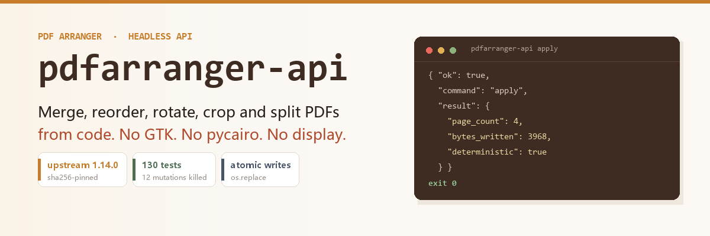
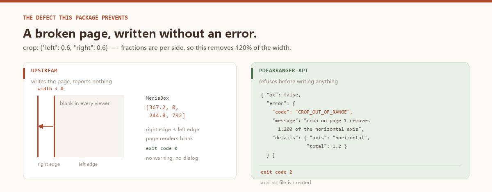
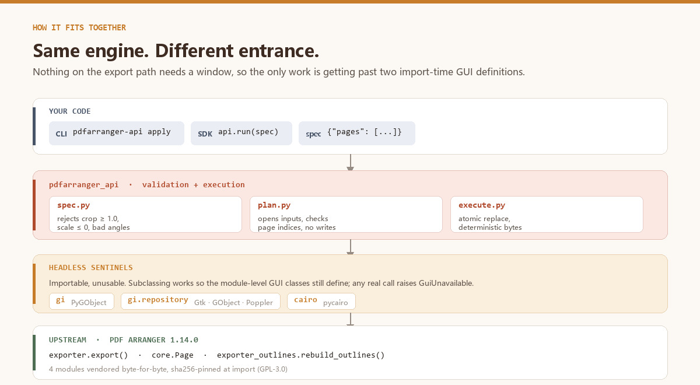

# pdfarranger-api



A headless **API, Python SDK and CLI** for [PDF Arranger](https://github.com/pdfarranger/pdfarranger)'s
page engine — merge, reorder, rotate, crop, scale and split PDFs from a script, a
CI job or another program, with no display, no GTK and no window.

```bash
pdfarranger-api inspect report.pdf
pdfarranger-api apply --json '{
  "inputs": [{"id": "a", "path": "report.pdf"}],
  "pages": [
    {"input": "a", "page": 1, "rotate": 90},
    {"input": "a", "page": "2-4", "scale": 0.5},
    {"input": "a", "page": 7, "crop": {"left": 0.1, "right": 0.1}}
  ],
  "output": "out.pdf"
}'
```

```python
from pdfarranger_api import run

run({
    "inputs": [{"id": "a", "path": "report.pdf"}],
    "pages": [{"input": "a", "page": "1-4"}],
    "output": "excerpt.pdf",
    "deterministic": True,
})
```

---

## Why this exists

PDF Arranger is a **6k-star GTK application**. Every operation — merge, reorder,
crop, rotate, split — is performed by dragging thumbnails. Its `man` page says it
plainly:

> **OPTIONS** — Currently PDF Arranger doesn't receive any options.

That is a shame, because the engine underneath is *pure pikepdf*. Nothing about
the page geometry needs a window. Two things stand in the way of calling it from
a program, and neither is a documentation problem:

**1. The engine cannot even be imported without GTK.**
`pdfarranger/core.py` executes two GUI class definitions at *module* scope:

```python
class PasswordDialog(Gtk.Dialog): ...          # line 451
class PDFRenderer(threading.Thread, GObject.GObject): ...  # line 821
```

Neither is on the export path. But because they are module-level, `import
pdfarranger.exporter` raises `ModuleNotFoundError: No module named 'gi'` on any
machine without PyGObject — a headless server, a slim container, a Windows box.

There is a second, quieter version of the same problem: `core.py` also does a
bare `import cairo` (line 46), used only by the thumbnail renderer. pycairo is a
compiled dependency that is missing on most headless boxes, and the export path
never touches it — but the import alone is enough to fail.

**2. Geometry mistakes are reported by writing a broken page.**
Crop fractions are per side. Ask for `left=0.6, right=0.6` and the engine
happily emits a page whose MediaBox is `[367.2, 0, 244.8, 792]` — the right edge
is *left of* the left edge. The PDF opens, the page renders blank, nothing
raises. `scale=0` and negative scales do the same. An out-of-range page index
surfaces as qpdf's `parsing numeric range for <input file>`, which names the
input rather than the offending entry.

This package fixes both, without forking the engine:



| | Upstream | Here |
|---|---|---|
| Import without GTK | ✗ | ✓ headless `gi` sentinel |
| Import without pycairo | ✗ | ✓ headless `cairo` sentinel |
| Programmatic entry point | ✗ (GUI only) | ✓ CLI + SDK + JSON spec |
| Crop overflow | silent negative-width page | `CROP_OUT_OF_RANGE` |
| `scale=0` | silent zero-size page | `SCALE_OUT_OF_RANGE` |
| Page out of range | qpdf message naming the file | `PAGE_OUT_OF_RANGE` naming the page |
| Overwrite protection | n/a | refuses unless `--overwrite` |
| Crash mid-write | truncated output | atomic replace |
| Reproducible bytes | timestamp varies | `deterministic: true` |
| Error contract | tracebacks / dialogs | 20 stable codes + exit codes |

Both sentinels are deliberately *loud*: importing succeeds, but any real use of
a GUI or cairo symbol raises `GuiUnavailable`. A no-op stub would let a future
upstream change route work through the GUI and fail invisibly.



## Install

```bash
pip install .
```

Requires Python ≥ 3.9 and `pikepdf >= 8`. **No GTK, no pycairo, no X11, no display.**

Verified by installing the wheel into a bare virtualenv with neither `gi` nor
`cairo` present and running a full merge/rotate/crop/blank-page job:

```
engine {'loaded': True, 'gi_mode': 'headless', 'cairo_mode': 'headless',
        'pikepdf': '10.17.0', 'error': None}
```

PDF Arranger is not published on PyPI, so the four modules the export path needs
are vendored verbatim under `pdfarranger_api/_vendor/pdfarranger/` (GPL-3.0,
`COPYING` included). They are byte-identical to upstream and pinned by sha256 in
`_engine.VENDOR_HASHES`; a modified file is refused at import time.

## The spec

A spec is plain JSON, so it can be generated by any language, committed, diffed
and replayed.

```jsonc
{
  "version": 1,
  "inputs": [
    {"id": "a", "path": "report.pdf"},
    {"id": "b", "path": "appendix.pdf", "password": "hunter2"}
  ],
  "pages": [
    {"input": "a", "page": 1, "rotate": 90},
    {"input": "b", "page": "1-3", "scale": 0.5},
    {"input": "a", "page": 7, "crop": {"left": 0.1, "right": 0.1,
                                        "top": 0.05, "bottom": 0.05}},
    {"blank": true, "width": 595, "height": 842},
    {"input": "a", "page": 2, "overlay": {"input": "b", "page": 1}}
  ],
  "output": "merged.pdf",
  "metadata": {"title": "Quarterly report", "author": "林白玉"},
  "deterministic": true
}
```

### Page fields

| Field | Type | Default | Notes |
|---|---|---|---|
| `input` | string | — | an `id` from `inputs[]` |
| `page` | number \| string \| array | — | `3`, `"1-3"`, `"1-3,7"`, `"3-"` (to the end), `[1,5]` |
| `rotate` | number | `0` | multiple of 90; normalised mod 360 |
| `scale` | number | `1.0` | `0 < scale ≤ 100` |
| `crop` | object | all `0` | fractions per side; opposite sides must sum `< 1.0` |
| `blank` | bool | `false` | requires `width` + `height` in points |
| `overlay` / `underlay` | object | — | `{"input": "b", "page": 1}` |

One `pages[]` entry may expand to many output pages: `"page": "1-3"` yields
three pages, each carrying that entry's `rotate`/`scale`/`crop`.

### Top-level fields

| Field | Type | Default | Notes |
|---|---|---|---|
| `version` | number | `1` | spec format version |
| `inputs` | array | required | `{id, path, password?}` |
| `pages` | array | required | output pages, in order |
| `output` | string | required | relative paths resolve against the spec file |
| `metadata` | object | `{}` | `title`, `subject`, `keywords`, `author`, `creator`, `producer` |
| `deterministic` | bool | `false` | byte-identical output across runs |
| `output_password` | string | `null` | encrypt the result |
| `split` | `"page"` | `null` | one file per page: `out-001.pdf`, `out-002.pdf` … |

Unknown fields are **rejected**, not ignored — a typo like `"rotation"` would
otherwise silently produce an unrotated page.

## CLI

Four subcommands. Every one prints a single JSON object on stdout, success or
failure, so a caller never has to parse prose.

```bash
pdfarranger-api capabilities            # what this build can do + its limits
pdfarranger-api inspect a.pdf b.pdf     # page counts, sizes, encryption
pdfarranger-api plan  --spec spec.json  # validate, print the plan, write nothing
pdfarranger-api apply --spec spec.json  # validate and write
```

`plan` reports `output_page_count` (how many pages the result will have) separately
from `inputs[].page_count` (how many pages each source has) — the two are easy to
confuse when a spec selects a subset.

| Flag | Applies to | Meaning |
|---|---|---|
| `--spec FILE` | plan, apply | read the spec from a file |
| `--json JSON` | plan, apply | inline spec instead of a file |
| `-o, --output FILE` | plan, apply | override the spec's `output` |
| `--overwrite` | apply | replace existing outputs (default: refuse) |
| `--dry-run` | apply | validate only |

### Exit codes

| Code | Meaning |
|---|---|
| `0` | success |
| `2` | bad usage or invalid spec |
| `3` | bad input (missing, unreadable, encrypted, page out of range) |
| `4` | refused (would overwrite, not writable, would clobber an input) |
| `5` | environment problem (engine unavailable) |
| `6` | internal error |

```jsonc
// failure envelope
{
  "ok": false,
  "command": "apply",
  "error": {
    "code": "PAGE_OUT_OF_RANGE",
    "message": "page 99 does not exist in 'basic.pdf' (it has 7 pages)",
    "exit_code": 3,
    "details": {"file": "basic.pdf", "page": 99, "page_count": 7},
    "hint": "Valid page numbers are 1..7."
  }
}
```

## Python SDK

```python
import pdfarranger_api as api

# One-shot
result = api.run(spec_dict, overwrite=True)
print(result.page_count, result.bytes_written)

# Validate without writing
plan = api.dry_run(spec_dict)
for page in plan.pages:
    print(page.index, page.source, page.width, page.height)

# Describe a file before writing a spec
api.inspect_pdf("report.pdf")["page_count"]

# Convenience wrappers
api.merge(["a.pdf", "b.pdf"], "merged.pdf")
api.reorder("a.pdf", [3, 1, 2], "reordered.pdf")
api.split_pages("a.pdf", "piece.pdf")     # piece-001.pdf, piece-002.pdf, ...
```

Everything raises `ApiError` with a stable `.code`; no pikepdf or qpdf exception
escapes.

```python
try:
    api.run(spec)
except api.ApiError as err:
    if err.code is api.ErrorCode.CROP_OUT_OF_RANGE:
        print(err.details["axis"], err.details["total"])
```

## Error codes

Branch on `code`, never on message text. Adding a code is a minor version bump;
renaming one is a major bump.

| Code | Exit | Raised when |
|---|---|---|
| `SPEC_INVALID` | 2 | spec is not structurally valid |
| `SPEC_UNKNOWN_FIELD` | 2 | unknown field (guards against typos) |
| `INPUT_NOT_FOUND` | 3 | input missing or not a regular file |
| `INPUT_NOT_PDF` | 3 | input unreadable as PDF |
| `INPUT_ENCRYPTED` | 3 | encrypted, no password supplied |
| `INPUT_PASSWORD_WRONG` | 3 | password rejected |
| `PAGE_OUT_OF_RANGE` | 3 | page index beyond the document |
| `NO_PAGES` | 2 | spec selects zero pages |
| `CROP_OUT_OF_RANGE` | 2 | crop negative, or opposite sides sum ≥ 1.0 |
| `SCALE_OUT_OF_RANGE` | 2 | scale ≤ 0 or > 100 |
| `ANGLE_INVALID` | 2 | rotation not a multiple of 90 |
| `OUTPUT_EXISTS` | 4 | output exists and `--overwrite` not given |
| `OUTPUT_NOT_WRITABLE` | 4 | directory missing or read-only |
| `OUTPUT_SAME_AS_INPUT` | 4 | output path collides with an input |
| `SPLIT_TOO_MANY_OUTPUTS` | 4 | split would exceed 512 files |
| `ENGINE_UNAVAILABLE` | 5 | vendored engine cannot load |
| `ENGINE_INTEGRITY` | 5 | vendored sources were modified |
| `GUI_UNAVAILABLE` | 5 | a GTK code path was reached headless |
| `INTERNAL_ERROR` | 6 | unexpected exception (type in `details`) |

## Guarantees, and how they are verified

| Guarantee | Verified by |
|---|---|
| Runs with no GTK / display | `test_engine.py` spawns a bare interpreter with no `DISPLAY` |
| Runs with no GTK **and** no pycairo | `test_engine_loads_when_cairo_and_gi_cannot_be_imported` blocks both via a meta-path finder in a subprocess |
| The shims fail loudly, not silently | `test_gui_constants_are_not_silently_available`, `test_gui_nested_call_fails_loudly`, `test_cairo_shim_installs_when_pycairo_is_absent` |
| Vendored engine is unmodified | sha256 pin at import + `tools/verify_vendor.py` |
| Vendored engine still *behaves* correctly | upstream's own 29 golden-file tests, run against the vendored copy by `tools/run_upstream_suite.py` |
| API output ≡ upstream output | `test_equivalence.py` drives upstream's `export()` directly and compares measured geometry |
| Broken input is refused | `test_upstream_writes_a_broken_page_for_overflowing_crop` documents upstream's silent corruption; the paired test asserts the API rejects it |
| Atomic writes | `test_output_lands_via_rename_not_in_place_write` asserts the destination is created by `os.replace` from a sibling temp file |
| Reproducible bytes | three runs compared by sha256, **plus** a control asserting non-deterministic mode really does vary |
| No noisy warnings on success | `test_metadata_does_not_emit_xmp_type_warnings` |
| Every error code reachable | each code has a test asserting the exact `ErrorCode`, at both SDK and CLI level |
| Tests can actually fail | `tools/mutation_check.py` injects 12 deliberate defects and requires each to be caught |

```bash
python -m pytest                    # 130 tests
python tools/verify_vendor.py       # vendor hashes
python tools/run_upstream_suite.py  # upstream's 29 golden tests
python tools/mutation_check.py      # 12 mutations must all be killed
```

## Limits

Honest boundaries rather than things to discover later:

- **Encrypted inputs** need `crypto` support in pikepdf (bundled in the wheels).
- **`split`** writes one file per page; it does not split by range. Use several
  specs, or call `run()` per range.
- **Overlay/underlay** takes one page per layer, positioned by upstream's default
  placement. Arbitrary per-layer offsets are not exposed yet — upstream supports
  them, the spec vocabulary does not.
- **Metadata** covers the six XMP fields PDF Arranger itself writes. Arbitrary
  XMP injection is out of scope.
- **Not a fork.** The engine is used exactly as upstream ships it. If upstream
  changes geometry semantics, this package follows it — which is why the golden
  suite is part of the test run rather than a one-off check.

## License

GPL-3.0-or-later. This package links against vendored PDF Arranger code
(GPL-3.0-or-later, © its contributors); `COPYING` is included under
`pdfarranger_api/_vendor/pdfarranger/`.

Upstream: <https://github.com/pdfarranger/pdfarranger> · 1.14.0 · main @ 2026-10-01
